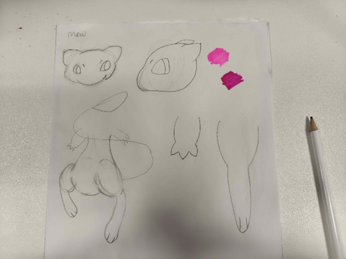
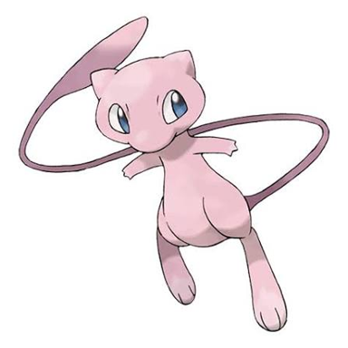
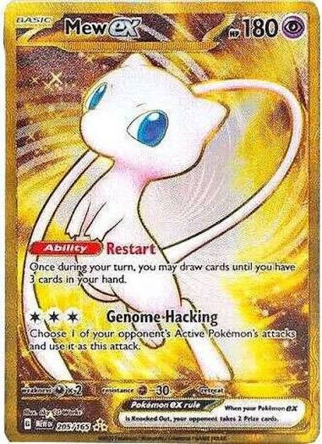

# F20GA - Emma Parfinowska

"Mew's overall physical appearance appears to be based on domestic cats. Several of Mew's features, such as a short muzzle and large hind feet, are commonly found in cats. Its morphology is also vaguely similar to a jerboa, having large hind legs and a long skinny tail." Bulbapedia (2026).

Mew is one of my favourite pokemon and wanted to try out making it in blender. I used some cards as well as other references of mew for my final design. 

I done some base sketches as well as added in reference images of what mew looks like

The Blender model will be based of off this character

# Diary
# 06/10/2026
- The fist sections on designing the model is starting whith a sphere then using the 'clay' and 'elastic' tool to change the shape of the body. My idea is to create the main shape of Mew then be able to rig the body and be able to pose with it. So after shaping the body i extended parts to make up the arms and legs. I then attached 3 cones to the end of the arms to create fingers for Mew. which look like claws. 

# 13/10/2026 
- I have added in more detail for the legs and feet. i used spheres and sculpted them to fit the thighs and feet. For the tail i originlyy used a sphere and shaped and streched it but I didnt like the look of it. I then found out how to use the curve tool, so i drew mews tail and filled it in and placed a sphere on the tip of the tail as it will match mews design. I have also added on the head but it needs shaping as it doesnt quite match its design. Added in the ears for mew and made an attempt for the eyes. mews eyes are a smooth triangle so i need to smooth the current eyes now as it looks out of place as just pointy triangles however, i got placement for it will be placed.

# 15/10/2026
- I have decided to scrap the triangular eyes entirely ad decided to hollow out the face and fill it in with spheres for the eyes. I have also redone the tail as it was to small in comaprison to mew. I now need to shape the head to the eyes so it fits better as well as rendering the body as well. 

# Final Design choices
- I plan to pose mew in a forest with some trees and grass and have it floating as it is a physcic pokemon. 

Reference: 

Bulbapedia (2026). Mew (Pokémon) - Bulbapedia, the community-driven Pokémon encyclopedia. [online] Bulbapedia. Available at: https://bulbapedia.bulbagarden.net/wiki/Mew_(Pok%C3%A9mon) [Accessed 13 Oct. 2026].